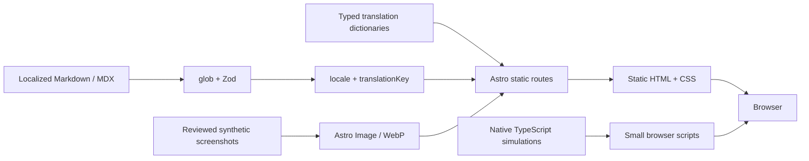

> 2026-10-23 更新：首頁與專案介紹已改為 V3 全螢幕互動群島；目前行為與內容維護以 [互動網站說明](docs/INTERACTIVE_WORLD.md) 為準。以下 V2 內容保留作為歷史決策紀錄，六步流程與 13 章案例不再是本輪驗收要求。

# 系統架構

V2 是 Astro 7 的純靜態內容網站。Node 24 僅用於開發／建置；訪客不需要 server、資料庫、登入或付費 API。

## 主要模組

| 位置                                          | 職責                                            |
| --------------------------------------------- | ----------------------------------------------- |
| `src/config.ts`                               | 公開身分與選填聯絡資訊                          |
| `src/lib/i18n.ts`                             | Locale 型別、字典、路徑 helper                  |
| `src/content/{projects,notes}/{zh-tw,en}/`    | 完整本地化內容，translationKey 配對             |
| `src/content.config.ts`、`src/lib/schemas.ts` | 內容型別、圖片、日期、來源版本與私人來源 guard  |
| `src/pages/[locale]/`                         | 兩語首頁、列表、案例、文章、About、Contact、404 |
| `src/layouts/Base.astro`                      | 語言導覽、metadata、hreflang、footer、少量互動  |
| `src/components/FlowSimulation.astro`         | 可及性控制、合成流程與狀態呈現                  |
| `src/lib/simulations.ts`                      | 純函式情境與步驟，不是業務後端                  |
| `src/components/LegacyRedirect.astro`         | 舊網址的靜態／無 JS 回退                        |
| `scripts/check-content.mjs`                   | 配對唯一性、完整翻譯、章節與證據一致性          |
| `scripts/check-seo.mjs`                       | 預覽／正式 fixture SEO 契約                     |

## 多語系與資料流

Astro 原生 `i18n` 設定 `defaultLocale: zh-tw`、`locales: [zh-tw,en]`、`prefixDefaultLocale: true`。`getStaticPaths` 在建置時生成明確語系路徑，不以瀏覽器偏好覆寫 URL。

Collections 保留兩種型別，依 locale 過濾列表，translationKey 尋找對應內容。案例與文章只有存在且可發布的配對才提供切換。缺譯不建立假翻譯。現有正式內容以內容契約要求兩語完整。草稿不輸出路由。

`render()` 取得 Content 與 headings。各語章節保持相同順序，語言切換透過該次建置的 heading slug 配對保留章節；共用 overview、deep-dive、evidence、simulation anchors 穩定不變。未知 hash 移除，避免把不成立的錨點帶入目的頁。query 保留；流程模擬重新載入時重設。

## 互動與降級

原生 TypeScript 處理選單、語言 hash、篩選及兩種流程。狀態由目前步驟和情境決定；沒有計時器、自動播放、rAF、Canvas、第三方動畫套件或 hydration runtime。重播回到第一步，再由訪客步進；重設恢復預設衝突情境與 0/6。

沒有 JS 時完整文章、案例與技術順序仍可讀；手機主要導覽直接顯示，流程 details 提供靜態文字等價。沒有真實請求、持久化或後端安全驗證。

## URL、安全與部署邊界

未知 SITE_URL 不生成 canonical／sitemap，robots Disallow、全頁 noindex；真實 HTTPS origin 啟用雙語 metadata、hreflang 與 sitemap，404／legacy 不納入 sitemap。SEO fixture 只用 reserved `.test`，輸出 ignored `.local`，不作正式身分。

靜態 host 通常只有一個 `404.html`；本機 fallback 依明確 `/en/` 前綴切換英語回復介面，無 JS 回退保留雙語入口。語系 `/en/404/`、`/zh-tw/404/` 為完整靜態本地化文件。正式 host 的 404／HTTP redirect 必須部署後再驗證。

MDX 作者需受信任，不接受外部匿名內容。私人來源不公開連結或程式碼；圖片為已審查合成資料。Workflow 僅授予 contents read，沒有 deployment job。來源 AssetFlow／BookFlow repository 僅唯讀，不改其程式。
