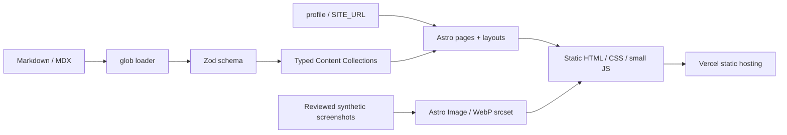

# 系統架構

Developer Portfolio 是 Astro 7 的純靜態內容網站。執行時不需要 Node server、資料庫、登入、付費 API 或 CMS；Node 24 僅用於開發與建置。

## 模組

| 路徑                     | 責任                                       |
| ------------------------ | ------------------------------------------ |
| `src/config.ts`          | 唯一個人資訊來源、導覽、語系               |
| `src/content.config.ts`  | Content Layer `glob()` loader、圖片 schema |
| `src/lib/schemas.ts`     | 型別化 frontmatter 欄位、日期與公開邊界    |
| `src/lib/content.ts`     | 篩選、排序、日期、中文閱讀時間             |
| `src/lib/metadata.ts`    | title、canonical、JSON-LD escaping         |
| `src/lib/site-url.mjs`   | 驗證真實 HTTPS origin                      |
| `src/layouts/Base.astro` | HTML、metadata、導覽、主題與 footer        |
| `src/components/`        | ProjectCard、ContactCTA、TableOfContents   |
| `src/pages/`             | 靜態路由與 robots endpoint                 |
| `src/content/`           | 專案案例、技術文章                         |
| `src/assets/`            | 經檢查的原始截圖，由 Astro 生成多尺寸圖片  |
| `public/`                | favicon 與 OG social card                  |
| `tests/`、`e2e/`         | 單元契約與正式靜態伺服器測試               |
| `scripts/`               | 可重現截圖、SEO fixture 與 Lighthouse      |

## 資料流

內容在建置時經 Zod 驗證，缺欄位、無效日期、私人來源連結或缺圖片會失敗。`getStaticPaths()` 依 collection entry ID 產生詳細頁，`render()` 同時提供 Markdown headings 作為目錄。草稿文章不會產生頁面，也不出現在列表或 sitemap。

主題、手機選單與列表篩選是少量原生 TypeScript；Astro 在建置時打包。不引入 Vue／React runtime，沒有 hydration island。篩選不影響靜態可讀內容，停用 JavaScript 仍可閱讀所有頁面與案例；手機選單與主題切換需 JavaScript。

## 語言擴充

第一版只有完整的 `zh-TW`，沒有空白英文入口。顯示身分與 locale 集中設定。未來加入英文時，以語系目錄拆分 collections 與 route，補齊翻譯後再加入 hreflang；目前不提前引入翻譯依賴。

## 安全邊界

內容作者是受信任的 repository 維護者，MDX 能執行元件，不接受匿名內容。對外無資料寫入端點；未建立聯絡表單。GitHub workflow 只授予 contents read。`.local`、`.env` 與測試產物不追蹤。Vercel headers 設定為靜態站適用的基本防護；正式 TLS、平台與網域仍需部署後驗證。

## 網址與索引

未設定 SITE_URL：不產生 canonical、og:url 或 sitemap，robots Disallow 且頁面 noindex。設定真實 HTTPS origin 後，產生 canonical、PNG Open Graph、structured data、robots 與 sitemap；404 永遠 noindex 且不列入 sitemap。測試中的 `portfolio.test` 僅為保留測試 origin，產物放 ignored `.local`，不作為網站預設網址。
