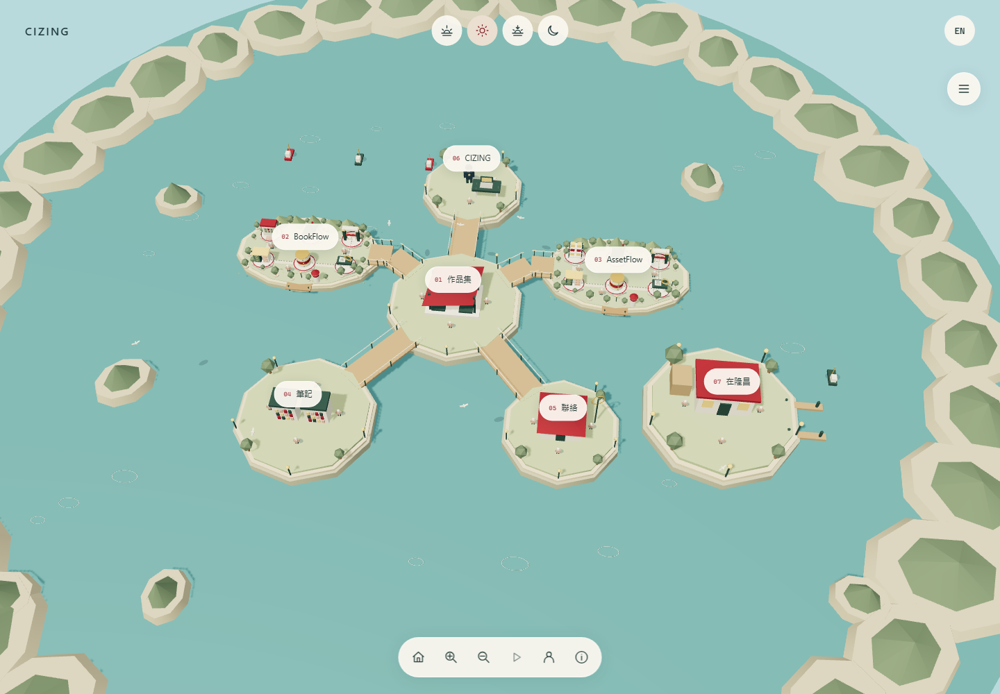

# Developer Portfolio V3 · 專案群島

CIZING 的中英文互動作品集。首頁有七座功能島：作品集、BookFlow、AssetFlow、筆記、聯絡、CIZING 與在隆昌。作品集、CIZING、筆記和聯絡可直接閱讀。BookFlow、AssetFlow 和在隆昌保留拉近探索與島上入口。在隆昌以獨立港口連接海路，周圍裝飾群島圍成有限海域。



## 目前體驗

- 六座主群島以橋梁連接，第七座在隆昌島沒有陸橋。人物可過橋，船隻以水路抵達港口；建築、樹木、燈柱、人物及碼頭有通行限制。
- 透明頁首只保留 CIZING、中英文切換和四個時段圖示。清晨、中午、夕陽與晚上會改變海面、光線、窗戶和路燈；移動物件的投影陰影持續更新。
- 右側清單可搜尋島嶼與內容、移動到該島、閱讀細節；底部以圖示控制全景、縮放、動態、個人角色與操作說明。
- 兩座專案島提供操作展示、產品功能和架構入口。完整案例包含公開實際截圖、使用流程、工程取捨與對應版本的來源和測試。
- Engineering Lab 將既有六篇雙語筆記、技術索引和公開案例整理成六個主題，可用關鍵字、分類及標籤篩選。預約一致性筆記包含可操作的併發模擬。
- 同頁原生 dialog 保留閱讀、Escape、焦點返回、瀏覽器上一頁與下一頁，以及中英文狀態。
- 個人島有原創的眼鏡、深色上衣與背包角色，可以自由行走及過橋；個人角色按鈕可找到目前位置。
- 相機、時段、選單與閱讀框使用平順過場；自主環境動態可暫停；系統設定減少動態效果時預設停用。開啟閱讀框、離開可見區域或隱藏分頁時停止場景更新。
- 第一個 WebGL 畫面繪製前顯示輕量載入畫面。初始化失敗或 context loss 時仍可閱讀，並可從替代地圖重試 3D。停用 JavaScript 時可直接閱讀獨立內容頁。

## 本機開啟

Node.js 24、npm。Windows 可使用 `npm.cmd`、`npx.cmd`。

```sh
npm ci
npx playwright install chromium
npm run dev
```

開啟 `http://127.0.0.1:4321/zh-tw/` 或 `/en/`。

```sh
npm run verify
npm run preview
```

`verify` 執行格式、靜態檢查、單元測試、內容契約、正式建置、SEO fixture 與四種螢幕尺寸的 Playwright／axe 驗證。詳細結果與限制見 [TESTING.md](TESTING.md)。

## 內容維護

- `src/lib/project-introductions.ts`：兩個專案的中英文目的、功能、架構與狀態，供島嶼閱讀框及獨立內容頁共用。
- `src/content/projects/`：專案中繼資料、真實畫面、來源版本及共用介紹元件入口。
- `src/content/notes/`：深入的工程筆記。它們與產品用途介紹分開閱讀。
- `src/components/EngineeringStudio.astro`：整站主介面。
- `src/lib/world-config.ts`：七座島、四時段與雙語內容入口的共同來源。
- `src/lib/world-map.ts`、`src/lib/navigation.ts`：島位、橋梁、地面／水域、路徑與碰撞。
- `src/lib/studio-scene.ts`：原創 Three.js 模型、相機、點選與環境動態。
- `src/lib/studio-reader.ts`：同頁閱讀、網址狀態、焦點、語言與分享。
- `src/components/EngineeringLab.astro`：群島閱讀框和獨立筆記頁共用的工程實驗室。
- `src/lib/studio-shadows.ts`：沿著共用橋面與島面高度繪製接觸及投射陰影。

沿用 Astro 7.4.2、TypeScript strict、Tailwind CSS 4、Content Collections、Markdown／MDX；新增 Three.js。仍為純靜態網站，無業務後端或資料庫。

## 公開邊界

場景人物及動態是視覺展示，不代表真實使用者或即時營運資料。專案畫面使用合成測試資料，網站沒有連線正式產品。AssetFlow 與 BookFlow 的案例連結到公開程式庫與對應版本的歷史驗證。公開作品集提供畫面、流程與瀏覽器模擬。棉麻屋的客戶畫面和部署網址維持私有。

作品集的本機測試、遠端 CI 與部署各自保留驗證紀錄；目前版本的合併與發布狀態請核對 GitHub PR 與 Cloudflare 部署。作品集測試不包含兩個來源專案的後端測試。

詳細設計與維護說明見 [互動網站說明](docs/INTERACTIVE_WORLD.md)。V2 歷史實測與證據保留在原文件及 `docs/evidence/v2/`，其效能分數不代表 V3。

本次八項更新、本機驗證及內容公開界線見 [七島更新紀錄](docs/LOCAL_ISLANDS_UPDATE.md)。

本機改版、效能取樣與代表性驗收見 [V3 本機交付報告](docs/V3_LOCAL_VALIDATION.md)。
