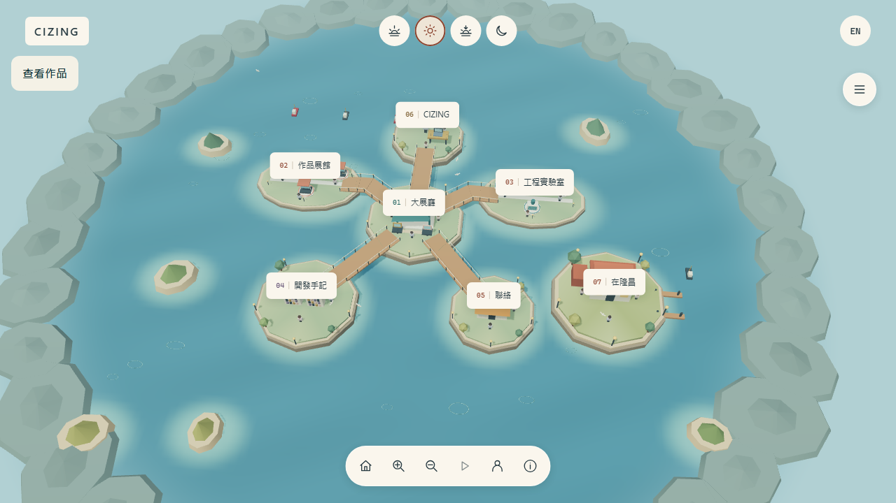
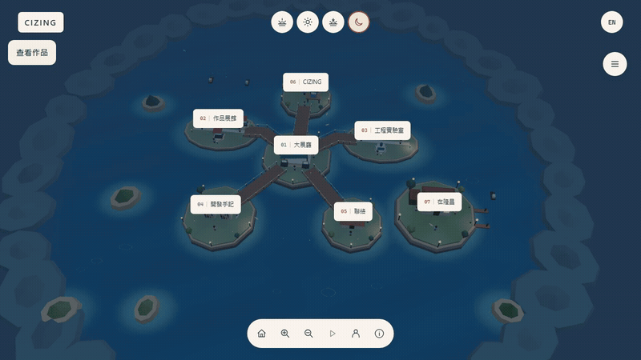
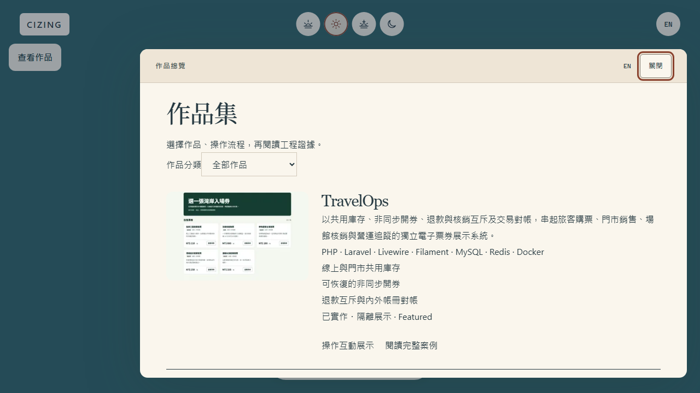
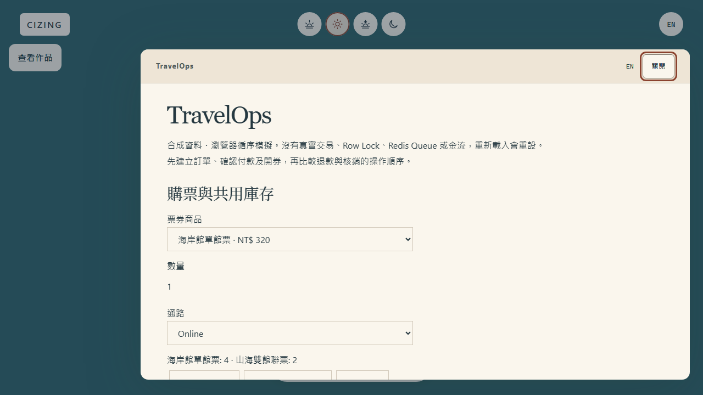
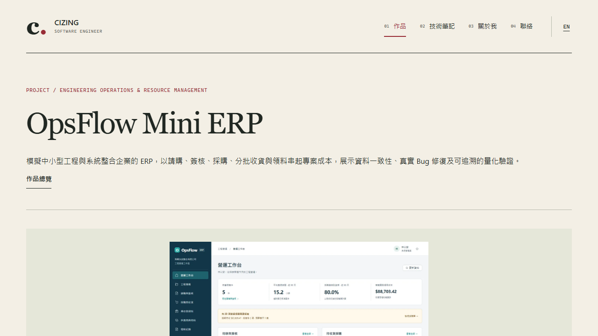
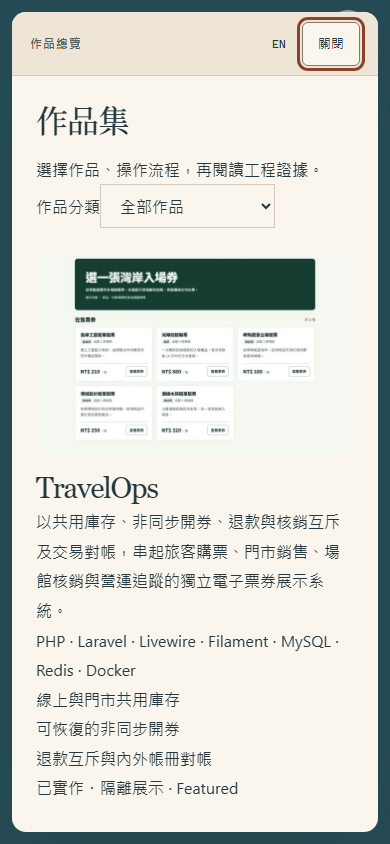
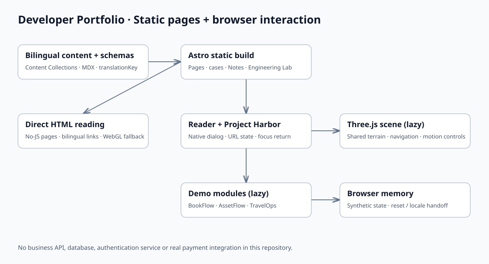

# Developer Portfolio · Project Harbor

CIZING 的繁中／英文工程作品集：從 3D 群島探索作品，也能直接閱讀案例、操作展示及測試證據。



[中文網站](https://cizing24-portfolio-test.pages.dev/zh-tw/) · [English website](https://cizing24-portfolio-test.pages.dev/en/) · [中文作品總覽](https://cizing24-portfolio-test.pages.dev/zh-tw/projects/)

## 操作展示



[觀看完整操作影片](docs/media/demo.mp4) · [媒體、版本與本次驗證](docs/SHOWCASE_VALIDATION.md)

影片與截圖來自本機正式建置。互動展示使用合成資料；瀏覽器內的購票、預約及資產操作，不連線來源產品的後端。影片檔隨 PR 交付，GitHub 若只顯示檔案頁，可下載播放。既有網站入口保留，本次沒有部署網站。

## 解決的問題與功能畫面

工程作品需要同時讓讀者看懂產品成果，以及往下追查實作與證據。網站提供互動探索和直接閱讀兩條入口，從作品展館找到案例，再查看流程、架構、技術取捨及對應來源版本。

### Project Harbor：集中瀏覽作品

作品由 Content Collections 決定，展館每頁三件，可篩選 Featured／其他作品。新增案例不必增加島嶼或重做場景。



### 互動展示：把規則變成可以操作的流程

TravelOps、BookFlow、AssetFlow 依需求載入互動模組。訪客可觀察庫存不足、付款通知重送、退款互斥、重複預約或資產狀態限制；這些是前端依序模擬，不證明資料庫並行控制。



### 案例閱讀：從產品流程追到工程證據

LegacyLens、OpsFlow、TravelOps、BookFlow、AssetFlow 的雙語案例提供真實產品畫面、業務流程與工程摘要。來源產品的測試證據與作品集自身測試分開記錄。



### 桌面與手機：保留直接閱讀入口

原生 dialog 支援 Escape、焦點返回與瀏覽器歷史。WebGL 無法使用時提供替代地圖；停用 JavaScript 時仍能閱讀獨立案例頁。



## Architecture



網站使用 Astro 靜態輸出，沒有業務 API、資料庫或登入服務。`src/content.config.ts` 與 schema 驗證雙語內容；`studio-reader.ts` 處理閱讀與網址狀態，`studio.ts` 按需載入場景，`src/lib/demos/` 分別載入三個操作展示。

[LegacyLens 雙語案例與驗證](docs/LEGACYLENS_INTEGRATION.md) · [V3 架構與操作](docs/V3_PROJECT_HARBOR.md) · [本次程式碼查核](docs/SHOWCASE_VALIDATION.md) · [雙語內容維護](CONTENT_GUIDE.md)

## Engineering Highlights 與技術決策

- **用固定功能分區容納作品。** Main Hall、Project Harbor、Engineering Lab、Notes、Contact、CIZING 與 Community 各自負責入口；一般作品可不提供 `demoModule`。舊作品島網址保留相容導向。
- **讓閱讀先開始。** 直接 `?view=projects` 或 `?view=project-travelops` 可延後下載 3D；展館先載封面，完整案例影片由使用者手動播放。互動 chunk 失敗時停用提交並提供重試。
- **共用地形和導覽資料。** `world-config.ts`、`world-map.ts` 與導航邏輯共同支援場景定位、地面／水域及碰撞規則。過去尋路優化逐項核對 9,012 個節點的座標、連線與連通區；[量測範圍](V3_FINAL_OPTIMIZATION_PR_VALIDATION.md)限定該歷史版本。
- **控制動畫生命週期。** 支援 Reduced Motion、動態暫停；開啟閱讀框、場景不可見或分頁隱藏時暫停更新，離頁釋放場景資源。
- **雙語內容使用契約。** 對應案例共用 `translationKey`，來源版本與可見性一致。OpsFlow 案例不設定公開 ERP Demo，私人案例只保留已審核素材及工程摘要。

## Testing & Results

LegacyLens 整合在 Windows／Node 24.22.1 重跑 `npm test`：**69／69 通過**；`npm run build`：**47 頁建置成功**。雙語案例、原始素材完整性、瀏覽器、無障礙與 SEO 結果見 [LEGACYLENS_INTEGRATION](docs/LEGACYLENS_INTEGRATION.md)。前次全站展示素材的檢查保留於 [SHOWCASE_VALIDATION](docs/SHOWCASE_VALIDATION.md)。

既有 [OpsFlow 整合驗證](docs/OPSFLOW_INTEGRATION.md)記錄首輪 188 項 E2E 中 180 通過，修正後重跑受影響的 24 項全數通過；沒有把兩輪描述成修正後完整重跑 188 項。[Project Harbor 驗收](docs/V3_PROJECT_HARBOR_VALIDATION.md)另保留互動規則、lazy loading、axe 及效能取樣限制。歷史效能數據不代表目前版本或真實裝置結果。

```sh
npm test
npm run test:content
npm run check:public
npx playwright install chromium
npm run verify
```

`verify` 包含 lint、格式、Astro check、TypeScript、Unit、雙語內容契約、build、SEO fixture 與四尺寸 Playwright。它不包含 `check:public`、`npm audit`、Lighthouse 或人工讀屏；[TESTING.md](TESTING.md)說明各自範圍。

## Tech Stack

Astro 7.4.13、TypeScript strict、Content Collections、Markdown／MDX、Tailwind CSS 4、Three.js；Vitest、Playwright、axe、Lighthouse。確切解析版本以 `package-lock.json` 為準。

## Getting Started

需要 Git、Node.js 24 與 npm。Windows 可使用 `npm.cmd`／`npx.cmd`。

```sh
git clone https://github.com/Cizing24/developer-portfolio.git
cd developer-portfolio
npm ci
npm run dev
```

開啟 [繁體中文](http://127.0.0.1:4321/zh-tw/) 或 [English](http://127.0.0.1:4321/en/)。首頁「查看作品」直接進入展館；`/zh-tw/projects/` 與 `/en/projects/` 可直接閱讀。

```sh
npm run build
npm run preview
```

[靜態建置與部署設定](DEPLOYMENT.md) · [互動網站維護](docs/INTERACTIVE_WORLD.md) · [前版七島更新紀錄](docs/LOCAL_ISLANDS_UPDATE.md)

## Project Status

目前是雙語靜態作品集，五個案例中三個具前端互動展示。LegacyLens 提供真實 Web Forms 操作影片、SQL Benchmark 與維護案例，OpsFlow 提供 ERP 案例與工程證據，兩者都沒有公開登入服務。來源產品的權限、資料庫、金流與背景工作不在本站執行；棉麻屋的客戶畫面與部署網址維持私有。

未驗證 Safari／Firefox、真實手機、人工讀屏與正式負載。Three.js 場景仍有大於 500 kB 的 chunk 建置警示；本次新增 LegacyLens 案例、媒體與證據入口，沿用既有場景與全站視覺，未變更正式部署設定。前版歷史效能資料保留在原文件，不能當作目前版本數據。

<details>
<summary>既有開發協作紀錄</summary>

Tanci 設定求職展示方向、案例順序、雙語與無障礙需求，以及素材公開範圍。Codex 協助實作案例導航與證據索引、核對來源專案、執行代表性檢查並重構本頁。 [公開協作紀錄](docs/AI_COLLABORATION.md) · [V3 整合 PR](https://github.com/Cizing24/developer-portfolio/pull/12)

</details>
