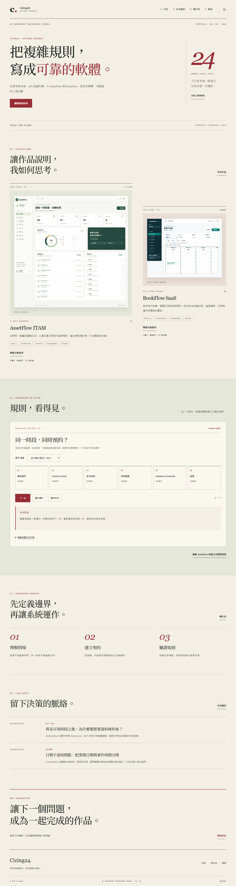

# Developer Portfolio V2

Cizing24 的雙語工程作品集。以 **Editorial Engineering Lab 70% + Interactive Systems Portfolio 30%** 呈現工程判斷：暖紙色、酒紅、襯線標題、不對稱作品編排，搭配能解釋資料一致性的流程模擬。

沿用 Astro 7.4.2、TypeScript strict、Tailwind CSS 4、Content Collections、Markdown／MDX 與 GitHub Actions。純靜態輸出，沒有 React／Vue runtime、業務後端或資料庫。Repository：[Cizing24/developer-portfolio](https://github.com/Cizing24/developer-portfolio)。**尚未公開部署。**



## 內容與互動

- AssetFlow ITAM、BookFlow SaaS：中英文完整案例，各保留 13 個工程章節；另有 Quick Overview、Engineering Deep Dive、Evidence & Verification。
- 兩篇完整中英文技術文章，保留程式碼、目錄、分類、標籤與閱讀導覽。
- BookFlow：Tenant Context、Tenant lock、鎖後時段重驗、GiST 約束、原子提交與衝突結果。
- AssetFlow：狀態、申請、RBAC、Employee／Asset 鎖、Serializable transaction、同交易稽核與成功／拒絕。
- 流程可點選步驟、鍵盤步進、重播、重設、切換情境。**僅為前端合成情境模擬，不呼叫後端，也不作為並行測試證明。**
- 全站移除普通連結／按鈕的裝飾箭頭；保留有意義的技術資料流敘述。

AssetFlow 來源為私人 repository，不公開私人程式或連結；BookFlow 保留已確認公開 GitHub。兩者均無假 Live Demo。沒有虛構姓名、任職、學歷、客戶成果或聯絡資訊。

## 本機啟動與驗收

Node.js 24（驗證版 24.22.0），npm。Windows 可使用 `npm.cmd`、`npx.cmd`。

```sh
npm ci
npx playwright install chromium
npm run dev
```

開啟 `http://127.0.0.1:4321/zh-tw/` 或 `http://127.0.0.1:4321/en/`。正式產物驗收：

```sh
npm run verify
npm run preview
# 另一終端，依序執行
npm run screenshots
npm run test:visual
npm run lighthouse
```

`verify` 包含 ESLint、Prettier、Astro Check、獨立 TypeScript Check、Vitest、內容契約、Production Build、SEO 契約與 Playwright／axe。視覺基準限定相同 OS／Chromium，先讀 [TESTING](TESTING.md)。不要在 Lighthouse 執行時同時跑其他瀏覽器測試。

未設定 SITE_URL 時刻意 noindex、不輸出假的 canonical／sitemap。正式網域未知，沒有填入虛構網址。設定真實 origin 會在 build 產生雙語 canonical、hreflang、sitemap 與 robots。

## 路由

下列每個頁面同時提供 `/zh-tw/` 與 `/en/` 前綴：

| 路徑（接在語系後）            | 內容                                        |
| ----------------------------- | ------------------------------------------- |
| `/`                           | 定位、作品、BookFlow 模擬、方法、筆記、聯絡 |
| `/about/`                     | 工程方法與實際技術方向                      |
| `/projects/`                  | 技術篩選與作品索引                          |
| `/projects/assetflow/`        | 完整 AssetFlow 案例與模擬                   |
| `/projects/bookflow/`         | 完整 BookFlow 案例與模擬                    |
| `/notes/`                     | 分類與標籤篩選                              |
| `/notes/booking-consistency/` | 預約一致性文章                              |
| `/notes/date-contracts/`      | 日期契約文章                                |
| `/contact/`                   | 真實 GitHub 與選填聯絡資訊                  |
| `/404/`                       | 對應語言的錯誤頁                            |

根路徑與原有無語系路由保留轉址頁；Vercel 同時準備 permanent HTTP redirect 設定，尚未部署驗證。無效路由回 HTTP 404，不回假首頁。案例語言切換保留 slug、query 與可對應章節，未提供對應翻譯時不顯示無效切換入口。

## 文件與證據

- [V2_IMPLEMENTATION](docs/V2_IMPLEMENTATION.md)：五階段實作與擴充方式。
- [V2_VALIDATION](docs/V2_VALIDATION.md)：本機驗證、修正、視覺與效能紀錄。
- [V2_MIGRATION](docs/V2_MIGRATION.md)：V1 轉址、內容與設計遷移。
- [ARCHITECTURE](ARCHITECTURE.md)、[DESIGN_SYSTEM](DESIGN_SYSTEM.md)、[CONTENT_GUIDE](CONTENT_GUIDE.md)、[DECISIONS](DECISIONS.md)、[TESTING](TESTING.md)、[DEPLOYMENT](DEPLOYMENT.md)。
- [來源公開邊界](docs/SOURCE_REVIEW.md)、[完整截圖索引](docs/screenshots/v2/README.md)。

V1 圖片為既有已提交網站截圖；V2 全部由本輪 Astro Production 產物重新擷取，沒有以探索原型冒充實作。原有測試與 Lighthouse 歷史報告保留在 `docs/evidence/`，V2 新報告在 `docs/evidence/v2/`，不能混用。

已知邊界：未部署、無正式網域；Safari／Firefox、實機觸控、人工讀屏與專業英文母語審稿尚未完成。Pixel 基準使用 Windows 系統字型；Linux CI 的可及性與版面契約獨立執行。
