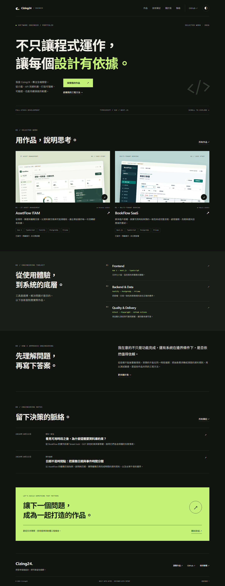

# Developer Portfolio

Cizing24 的軟體工程師個人品牌網站。以實際專案與可查證案例呈現全端開發、資料一致性及測試方法。

本專案採 Astro 靜態輸出，不包含資料庫、登入、付費 CMS 或假聯絡表單。主要語言為臺灣繁體中文，深色優先並可切換淺色。

Repository：[Cizing24/developer-portfolio](https://github.com/Cizing24/developer-portfolio)。**尚未部署公開網站**，目前提供本機啟動與 Vercel 靜態部署設定。



## 展示內容

- **AssetFlow ITAM**：企業資產生命週期、交易一致性、權限與稽核。私人來源不公開連結，只提供查證摘要及合成資料實際截圖。
- **BookFlow SaaS**：多租戶預約、排程、GiST 排他約束、冪等與 Outbox。提供公開 GitHub 連結。
- 兩個案例各有 13 個章節，清楚區分實作、驗證紀錄、尚未完成與未公開部署。
- 兩篇由來源專案查核的技術文章，支援分類、tags、目錄、程式碼高亮、日期與閱讀導覽。
- 響應式導覽、主題、技術篩選、skip link、鍵盤 focus、404、SEO 與結構化資料。

沒有捏造真名、工作經歷、學歷、Email、LinkedIn 或 Demo。來源查核版本與圖片公開範圍見 [SOURCE_REVIEW](docs/SOURCE_REVIEW.md)。

## 本機啟動

需求 Node.js 24（驗證版 24.22.0）、npm。所有指令在 repository 根目錄執行。

```sh
git clone https://github.com/Cizing24/developer-portfolio.git
cd developer-portfolio
npm ci
npm run dev
```

開啟 `http://127.0.0.1:4321/`。Windows PowerShell 可使用 `npm.cmd`／`npx.cmd`。

正式編譯後預覽：

```sh
npm run build
npm run preview
```

不需 `.env` 即可啟動。未設定真實 SITE_URL 時，網站刻意 noindex 且不輸出假 canonical 或 sitemap；配置方式見 [DEPLOYMENT](DEPLOYMENT.md)。

## 技術架構

Astro 7.4.2、TypeScript 5.9 strict、Tailwind CSS 4.3.3、MDX 8.1.1、Markdown、Content Layer `glob()` loader、Zod 4。建置時驗證內容並產生 HTML／CSS／少量原生 JS，沒有 React／Vue runtime 或 hydration。Astro Image 生成 WebP、srcset 與 sizes，使用系統字型與本機資產。

品質工具：Vitest 5、Playwright 1.64、axe、ESLint 10、Prettier、Lighthouse 13、GitHub Actions。直接依賴固定版本，保留 package-lock。

## 品質檢查

```sh
npx playwright install chromium
npm run verify
npm audit
npm run check:public
```

本機實測：24 Unit、24 E2E（3 裝置）、Lint／Format／Astro Check／Build／SEO contract 通過；audit 0。主要頁面 axe 檢查零 violations，不宣稱完整 WCAG 合規。完整條件、修正與限制見 [TESTING](TESTING.md)。

Lighthouse 本機 Production 靜態產物：手機首頁 Performance 90、桌面 100、手機 BookFlow 案例 89；Accessibility／Best Practices 均 100。SEO 為 63／63／66，因未知正式網址時刻意禁止索引；真實網址設定下的 SEO 輸出另以隔離 fixture 驗證。這些分數不是公開網路或真實使用者測量。

瀏覽器證據可重新產生：在另一終端啟動 preview，再執行 `npm run screenshots`／`npm run lighthouse`。

## 頁面

| URL                           | 內容                                       |
| ----------------------------- | ------------------------------------------ |
| `/`                           | 定位、精選作品、技能、工程方法、文章、聯絡 |
| `/about/`                     | 技術方向與工程方法                         |
| `/projects/`                  | 可依技術篩選的作品                         |
| `/projects/assetflow/`        | AssetFlow 完整案例                         |
| `/projects/bookflow/`         | BookFlow 完整案例                          |
| `/notes/`                     | 分類與標籤篩選                             |
| `/notes/booking-consistency/` | 預約一致性文章                             |
| `/notes/date-contracts/`      | 日期契約文章                               |
| `/contact/`                   | 真實 GitHub、選填聯絡資訊                  |
| `/404.html`                   | 自訂錯誤頁；無效路由 HTTP 404              |

Astro 的 `src/pages/404.astro` 對應特殊 404 輸出，訪問無效 `/404/` 路徑亦由 fallback 顯示該頁。

## 維護與文件

- [ARCHITECTURE](ARCHITECTURE.md)：模組與資料流。
- [CONTENT_GUIDE](CONTENT_GUIDE.md)：新增作品、文章、個人資訊。
- [DESIGN_SYSTEM](DESIGN_SYSTEM.md)：token、排版、響應式與互動。
- [TESTING](TESTING.md)：真實驗證、報告與邊界。
- [DEPLOYMENT](DEPLOYMENT.md)：Vercel、網址、驗收與回滾。
- [DECISIONS](DECISIONS.md)：選型、替代方案與面試脈絡。
- [PROGRESS](docs/PROGRESS.md)：Phase 1–4 里程碑。

## 已知限制與後續

尚未部署 Production，正式 TLS／CDN／SEO／社群預覽仍需發布後驗證。Safari／Firefox、人工讀屏與實體手機未驗證。只有 zh-TW，未放未翻譯的英文入口。可選的真名、Email、LinkedIn、履歷與正式網址待本人補充；這些空值不會產生假的按鈕。

後續優先補充真實個人定位與履歷、取得公開網址後執行遠端驗收，再增加新作品與文章。手機案例 Lighthouse TBT 仍有改善空間，應以固定環境與實際部署量測定位。
