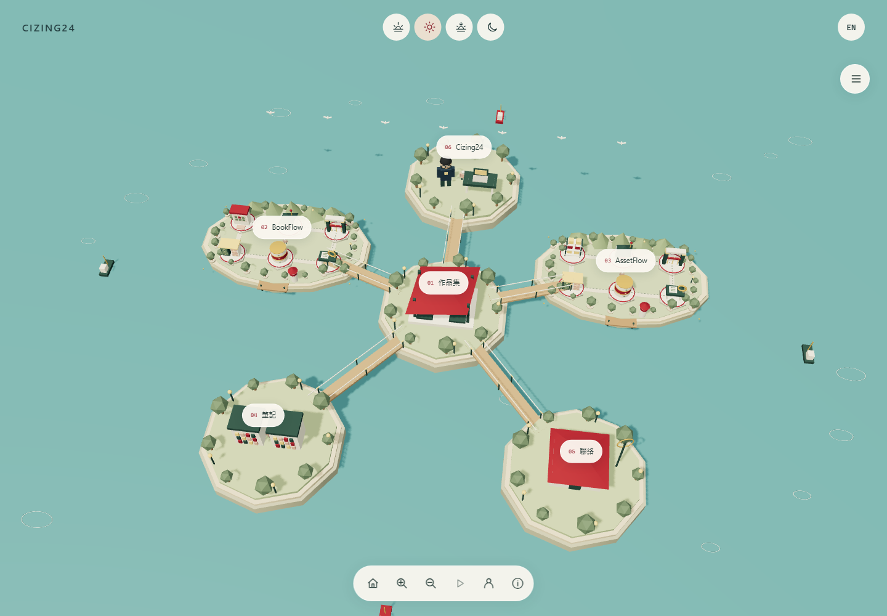

# Developer Portfolio V3 · 專案群島

Cizing24 的中英文互動作品集。首頁是由六座島組成的 3D 探索世界：作品集、BookFlow、AssetFlow、筆記、聯絡與 Cizing24。點選島嶼移動視角，再選擇內容開啟同頁閱讀框。



## 目前體驗

- 六座固定位置的原創程序小島，以橋樑連接；小型島名標籤搭配建築、樹木、行走人物、船隻與鳥群。
- 透明頁首只保留 CIZING24、中英文切換和四個時段圖示。清晨、中午、夕陽與晚上會改變海面、光線、窗戶和路燈。
- 右側清單可搜尋島嶼與內容、移動到該島、閱讀細節；底部以圖示控制全景、縮放、動態、個人角色與操作說明。
- 兩座專案島各有三個入口：目的、作用、架構。說明以產品用途為主，不要求訪客先理解交易鎖或錯誤碼。
- 同頁原生 dialog 閱讀：兩個專案、兩篇工程筆記、個人介紹、聯絡與操作說明。支援 Escape、焦點返回、瀏覽器上一頁與中英文狀態保留。
- 個人島有原創的眼鏡、深色上衣與背包角色，會揮手；個人角色按鈕可直接找到他。
- 相機、時段、選單與閱讀框使用平順過場；自主環境動態可暫停；系統設定減少動態效果時預設停用。開啟閱讀框、離開可見區域或隱藏分頁時停止場景更新。
- WebGL 不可用或 context loss 時，仍有可操作的主題地圖與閱讀框。未啟用 JavaScript 時可直接閱讀獨立內容頁。

## 本機開啟

Node.js 24、npm。Windows 可使用 `npm.cmd`、`npx.cmd`。

```sh
npm ci
npx playwright install chromium
npm run dev
```

開啟 `http://127.0.0.1:4321/zh-tw/` 或 `/en/`。

```sh
npm run verify
npm run preview
```

`verify` 執行格式、靜態檢查、單元測試、內容契約、正式建置、SEO fixture 與四種螢幕尺寸的 Playwright／axe 驗證。詳細結果與限制見 [TESTING.md](TESTING.md)。

## 內容維護

- `src/lib/project-introductions.ts`：兩個專案的中英文目的、功能、架構與狀態，供島嶼閱讀框及獨立內容頁共用。
- `src/content/projects/`：專案中繼資料、真實畫面、來源版本及共用介紹元件入口。
- `src/content/notes/`：深入的工程筆記。它們與產品用途介紹分開閱讀。
- `src/components/EngineeringStudio.astro`：整站主介面。
- `src/lib/world-config.ts`：六座島、四時段與雙語內容入口的共同來源。
- `src/lib/studio-scene.ts`：原創 Three.js 模型、相機、點選與環境動態。
- `src/lib/studio-reader.ts`：同頁閱讀、網址狀態、焦點、語言與分享。

沿用 Astro 7.4.2、TypeScript strict、Tailwind CSS 4、Content Collections、Markdown／MDX；新增 Three.js。仍為純靜態網站，無業務後端或資料庫。

## 公開邊界

場景人物及動態是視覺展示，不代表真實使用者或即時營運資料。專案畫面使用合成測試資料，網站沒有連線正式產品。AssetFlow 原始碼為私人專案；BookFlow 保留已確認的公開來源。未提供假登入或假 Live Demo。

本輪交付為本機實作與驗證；未部署 Production、未合併 PR，亦未重新執行兩個來源專案的後端測試。

詳細設計與維護說明見 [互動網站說明](docs/INTERACTIVE_WORLD.md)。V2 歷史實測與證據保留在原文件及 `docs/evidence/v2/`，其效能分數不代表 V3。
